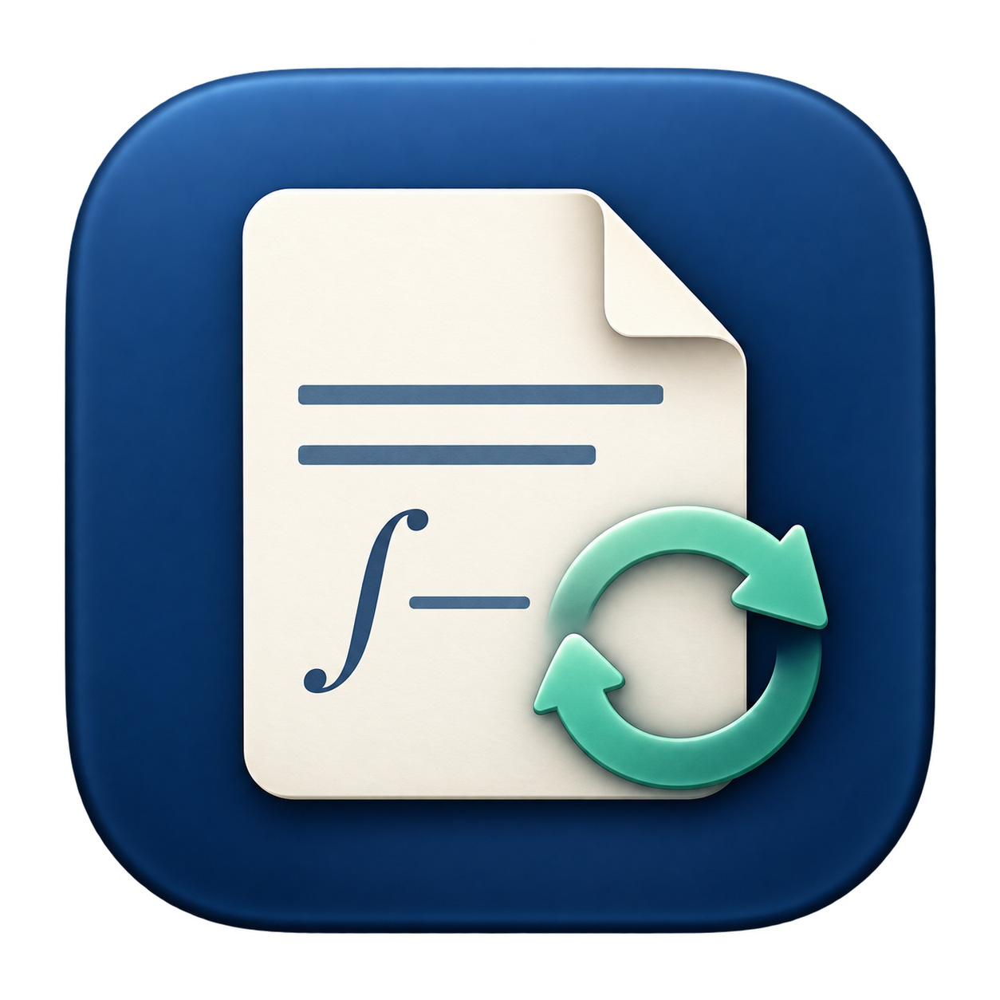

# 阅卷 · Yuyan PDF Viewer



A native macOS PDF viewer for papers that are continuously rebuilt with LaTeX. Application logic is written in **Yuyan**, compiled to **Wasm-GC**, and executed by embedded **V8**. AppKit and PDFKit provide the native interface and rendering.

## Download

[Download the latest release](https://github.com/UltimatePea/yuyan-pdf-viewer/releases/latest).

Unzip `Yuyan-PDF-Viewer-v0.2.9-macos-arm64.zip`, then open `阅卷.app` or move it to Applications.

- **Apple Silicon (arm64), macOS 26 or newer.** Intel builds are not included.
- Node/V8 and all non-system dynamic libraries are bundled. No Homebrew or Node installation is required to run the release.
- The app is ad-hoc signed, **not Apple-notarized**. macOS may require explicit approval in Privacy & Security before first launch.
- SyncTeX navigation optionally requires an installed `synctex` executable and a matching `.synctex.gz` file.

## Features

- Separate native windows for different documents, each with independent reading position, reloads and history. Open via **⌘O**, Finder or drag-and-drop; **⌘N** creates an empty window and **⌘W** closes the current window. **⌘`** cycles forward through windows; **⇧⌘`** cycles backward. Opening an already open PDF brings its existing window forward.
- Native continuous scrolling, page navigation, zoom, fit to width, text selection and printing.
- Search highlights all matches as you type. Previous and Next buttons sit beside the search field; **⌘G** / **⇧⌘G** navigate matches with wraparound. Search results update after refreshes and version changes, independently in each window.
- File and directory notifications detect in-place rewrites, atomic replacement and delete/recreate cycles.
- Debounced reloads retain the last valid PDF through partial writes and reject stale asynchronous results.
- Invalid text ranges reported by PDFKit are skipped before text extraction, preventing fatal range-conversion crashes while keeping the PDF available for reading.
- The bottom status shows the last successful PDF update in system-local time, including seconds (`YYYY-MM-DD HH:mm:ss`); unchanged content does not reset it.
- Text anchors preserve the reading passage and its viewport position across page insertion/deletion, with coordinate fallback for image-only pages.
- Persistent jump points with direct top-bar buttons, optional names, and keyboard shortcuts.
- PDF version history, stored on disk, with Previous, Next and Latest navigation and menu items to remove versions.
- Change highlights between consecutive versions: added words in green, words the next version deletes in red. On by default; **View → Highlight Changes** turns them off.
- An overview bar along the left edge marks where the changes are in the whole document, and **↑ / ↓** buttons step through them.
- Optional Follow Edits mode and source-to-PDF navigation through a simple CLI.

Anchoring is heuristic: extensive reflow, ambiguous text or formula-only content can fall back to the original page coordinates.

## Version history

Every successfully loaded content change is retained as an immutable PDF snapshot with its original update timestamp, and is **stored on disk**, so the history is still there after the app is quit and reopened. After the first refresh, compact **‹ vN/Total ›** controls appear in the toolbar: the arrows move between versions, and clicking the version counter returns to Latest. The **Versions** menu lists every snapshot by number and timestamp.

- **⌥⌘[**: previous version; **⌥⌘]**: next version; **⌥⌘0**: latest version.
- While viewing an older version, new successful refreshes are collected without replacing what you are reading. Returning to Latest resumes live updates.
- Version changes preserve zoom, display mode and the reading position using the same heuristic text anchors. Viewing history never writes an old PDF back to disk.
- Histories are separate for each PDF path. Moving or renaming a PDF starts a new history.
- Invalid/partial reads, stale asynchronous results and consecutive identical content are excluded. Rapid builds overwritten before the viewer captures them cannot be recovered. A disk revert to earlier content is retained as a new chronological version.

**Stored versions.** Versions are kept in `~/Library/Application Support/YuyanPDFViewer/Versions/`, in one folder for each PDF. Each version is a copy of the PDF, named by its time and content hash, with two cache files that hold its extracted lines and words. When a PDF is opened, its latest stored version is shown at once, and the file on disk is then read as usual; older versions are read only when they are shown or compared, and every version captured or read during a session stays in memory until the app quits. Nothing is removed automatically, so the folder grows with every rebuild: a 200-page paper takes about 3 MB for each version. The last line of the **Versions** menu shows how many versions of the document are stored and their size. A version that cannot be written is kept for the session, and the status bar says `not saved to disk`.

**Removing versions.** The **Versions** menu has three items for this, without shortcuts:

- **Remove This Version** removes the version on screen and shows the one after it, or the one before it if it was the latest.
- **Remove Version** lists every version; choose one to remove it without leaving the version on screen.
- **Remove Earlier Versions…** removes every version before the one on screen.

A removed version is deleted from memory and from disk and cannot be restored, so each removal asks for confirmation first. For a single version the confirmation has a **Do not ask again** box; **Remove Earlier Versions…** always asks. To be asked again, run `defaults delete org.yuyan.reader RemoveVersionsWithoutAsking`. The last remaining version cannot be removed. Once a version is gone, its neighbours are compared with each other. So when one build contains an edit you did not want and a later build reverts it, remove the version in between: the highlights then show only the real difference. Removing versions never touches the PDF itself. If the latest version is removed while the file still has that content, the content is recorded again the next time the file is read.

Explicit SyncTeX navigation returns to Latest, because the source and SyncTeX files describe the current build. [Changelog](CHANGELOG.md).

## Change highlights

Each version is compared with its neighbours, word by word. Words **added** since the previous version have a **green** background. While you view an older version, words that the **next version deletes** have a **red** background, so stepping back with **⌥⌘[** shows what an edit removed. The status bar reports the word counts, such as `+72 −147`. The latest version has only green highlights, and the first version only red ones.

- On by default. **View → Highlight Changes** turns the highlights off or on in every window, and the choice persists across launches.
- Layout changes are not changes. Margin line numbers (such as those of `lineno`), page numbers, running headers and footers, rebroken lines and words re-hyphenated at a line end are ignored. Text that only moved to another page, or that PDFKit reports in another order while it stands in the same place, is not marked. Text that really moved within a page is marked.
- A rebuild that changes no words is passed over. Each version is compared with the nearest earlier and the nearest later version whose words differ, so a rebuild without edits keeps the highlights of the last change.
- Change highlights and search highlights are shown together, and are rebuilt after refreshes, version changes and reopening a document. They use the extracted text only and never modify the PDF.
- Each snapshot in the history also keeps its word list, about 24 bytes per word.

**Overview bar.** A narrow bar along the left edge of the window stands for the whole document from top to bottom, like a scrollbar with marks. Green marks on its right half are additions; red marks on its left half are deletions by the next version. A grey block shows the part of the document in view. Click or drag on the bar to go to that place, or click a mark to go to that change.

**Previous and next change.** The **↑** and **↓** buttons beside the version controls go to the previous and the next set of changes, as do **⌥⌘↑** and **⌥⌘↓** and the View menu. Changes on one page that lie within about two lines of each other form one set. A visited set is placed three tenths below the top of the view, the status bar shows its number, such as `Change 3/12`, and the bar outlines it. While the visited set is still in view, stepping goes on from it. Otherwise **↓** takes the first change at or below the top of the view, so a change already on screen comes first, and **↑** takes the last change above the view. Both wrap around.

The bar and the two buttons are hidden while highlights are off.

The comparison is heuristic. It follows the order in which PDFKit extracts text, so reordered columns, moved floats and formulas whose extracted text changes can be marked. A word that differs only by a hyphen is not marked. A number that opens or ends a line apart from its text, as in some tables, is treated as a line number, and a line that repeats at the top or bottom of three or more pages as a header or footer. Where PDFKit glues a margin number to the last word of a line, the highlight leaves out that word's last letter, whose position PDFKit misreports.

## Jump points

Press **⌘D** or click **Set Point** to save the current reading location instantly. Unnamed points use **A, B, … Z, AA, AB…**, skipping labels already in use. Press **⇧⌘D** or right-click **Set Point** to supply a custom name.

The toolbar uses **one row when everything fits**. When space is tight, history and saved points move to a **second row**, keeping labels and search readable. Saved points appear as small named buttons beside Set Point: click one to jump, or use **⌘1–⌘9** for the first nine points in display order. Right-click a point for **Jump to Point**, **Rename…** and **Remove Jump Point**; renaming and removal has no shortcut or extra toolbar button. The Jump Points menu also exposes these actions. Scroll the inline point area horizontally when it fills up; it remains horizontally scrollable even in the overflow row.

Renaming changes only the label: the saved location, button order and jump shortcut stay the same. Names may contain Unicode; an empty rename keeps the existing name.

Points are stored separately for each PDF path, survive app restarts, and update their text anchors after successful rebuilds without moving your reading position. Jumping preserves your current zoom and display mode. If the target text is gone or cannot be extracted, the app uses a safely clamped page-coordinate fallback and reports an approximate location. Moving or renaming the PDF does not migrate its saved points. Concurrent app instances editing points for the same PDF use the last saved list.

## Build and test

Development requires Xcode Command Line Tools, Node 26 headers/libraries, and a compatible Yuyan checkout. The validated [Yuyan toolchain](https://github.com/yuyan-lang/yuyan) commit is `57be1c544e1898540509c9f3c773dd57f9fc8ae6`. The matching standard-library sources are included in `第三方/标准库`.

```sh
YY_ROOT=/path/to/yuyan-wktree-1 ./构建.sh
./运行.sh /path/to/paper.pdf
./测试.sh
# Build a self-contained release ZIP:
YY_ROOT=/path/to/yuyan-wktree-1 ./发布.sh
```

Tests run in the background without activating the app. Set `YY_VIEWER_BACKGROUND=1` when running an individual test script. In background mode the app never reads or writes your stored versions; it stores versions only when `YY_VERSIONS_DIRECTORY` names a folder. Tests run the actual Yuyan Wasm-GC application with PDFKit. The integration suite also requires `latexmk` and LaTeX. A logged-in macOS graphical session is required. To run the private-document crash regression as well, set `YY_CRASH_PDF=/path/to/test-copy.pdf`; the test creates another temporary copy and never rewrites the supplied file.

```sh
# Navigate an already-open PDF after compilation:
./运行.sh --navigate /path/to/paper.pdf /path/to/source.tex 120
```

[详细说明（现代汉语）](自述.汉语.md) · [文言说明](自述.文言.md) · [Icon generation prompt](资源/图标提示词.汉语.md)

License: GPL-3.0-or-later. Bundled third-party libraries retain their own licenses, included inside the app.
